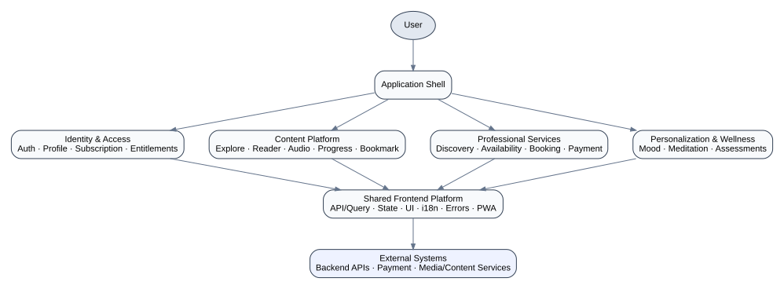
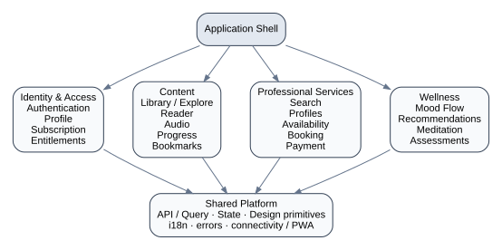

# Frontend Architecture Case Study

## Architecting a multi-domain, multilingual subscription and wellness platform

> An anonymized engineering case study based on a production frontend I designed and developed.  
> This repository documents architectural reasoning, domain modeling, trade-offs, testing strategy, and representative reference models. It does **not** publish proprietary application source code.

<p align="center">
  
</p>

## Why this repository exists

Large frontend systems are rarely difficult because of JSX. They become difficult when product rules, lifecycle boundaries, asynchronous server state, payments, media, localization, time-based access, and user journeys begin interacting.

The production application behind this case study grew into a multi-domain product containing:

- multilingual authentication and onboarding;
- freemium and subscription-gated content;
- text and audio book summaries;
- a configurable reader with persisted reading preferences;
- persistent audio playback across navigation;
- reading/listening progress and bookmarks;
- limited-time free content;
- professional discovery, availability, booking, and payment;
- session reminders, history, and post-session reflection;
- a mood-driven, multi-step recommendation journey;
- guided and ambient meditation experiences;
- data-driven psychological assessments and result analysis;
- discovery/feed, profile, notifications, social interactions, courses, PWA, connectivity, and theme-related feature areas visible in the supplied feature inventory.

The goal is not to show how many libraries were used. The goal is to show **how product complexity was turned into explicit frontend boundaries and engineering decisions**.

---

## Read this in 3, 10, or 30 minutes

| Time | Suggested path | What you should learn |
|---|---|---|
| **3–5 min** | This README | Product complexity, architecture shape, technology snapshot, strongest engineering decisions |
| **10–15 min** | [Architecture Overview](docs/02-architecture-overview.md) + one [Hero Deep Dive](#hero-deep-dives) | How state, boundaries, lifecycles, and failure modes were modeled |
| **30+ min** | Deep dives + [ADRs](docs/decisions/README.md) + [Testing Strategy](docs/16-testing-strategy.md) | Trade-offs, alternatives, testing philosophy, retrospective improvements |

---

## Executive summary

The frontend had to support several different business domains while preserving a coherent application shell and reusable platform capabilities.

The most important engineering problems were not isolated UI components. They were cross-cutting rules and long-lived workflows:

1. **Identity is not access.** A signed-in user may still be denied premium content, temporarily granted promotional access, or redirected to an upgrade flow.
2. **Media lifecycle is not route lifecycle.** Audio should keep playing while pages mount and unmount.
3. **Booking is not a form submit.** Availability can become stale between discovery, slot selection, payment, and booking confirmation.
4. **Server state and client state have different owners.** Cached API data, audio runtime state, local UI state, and persisted preferences should not be collapsed into one global store.
5. **Recommendation and assessment flows are stateful journeys.** They benefit from explicit transitions and data-driven definitions rather than page-specific branching.
6. **Localization is structural.** Language affects directionality, typography, dates, numbers, layout, and content—not only translated strings.
7. **Testing should follow business risk.** Entitlements, payment transitions, scoring, progress, and lifecycle edges deserve more attention than implementation-detail coverage.

---

## Architecture at a glance

The diagrams in this repository are **conceptual and intentionally simplified**. They describe useful architectural boundaries without reproducing the proprietary repository structure.

<p align="center">
  
</p>

A useful mental model is:

```text
Application Shell
│
├── Identity & Access
│   ├── Authentication
│   ├── Profile
│   ├── Subscription
│   └── Entitlements
│
├── Content Platform
│   ├── Discovery / Library
│   ├── Reader
│   ├── Audio
│   ├── Progress
│   └── Bookmarks
│
├── Professional Services
│   ├── Search / Filters / Sort
│   ├── Professional Profiles
│   ├── Availability
│   ├── Booking
│   └── Payment
│
├── Personalization & Wellness
│   ├── Mood Flow
│   ├── Recommendations
│   ├── Meditation
│   └── Assessments
│
└── Shared Frontend Platform
    ├── API / Query layer
    ├── Application state
    ├── Design-system primitives
    ├── Internationalization
    ├── Error handling
    ├── Connectivity / PWA
    └── Notifications
```

### Dependency principle

```text
Application composition
        ↓
Feature / domain modules
        ↓
Shared platform primitives
```

The rule is more important than the folder names: **a feature should depend on public contracts, not another feature's internal implementation**.

---

## Hero deep dives

These five areas carry the strongest senior-level engineering signal.

| Deep dive | Why it matters | Key question |
|---|---|---|
| [Subscription & Entitlements](docs/deep-dives/01-entitlements.md) | Freemium + premium + expiry + temporary access | How do you keep business access rules out of scattered UI conditionals? |
| [Persistent Audio Runtime](docs/deep-dives/02-persistent-audio.md) | Playback must outlive route components | Where should media state live, and how do you control render frequency and race conditions? |
| [Booking & Payment](docs/deep-dives/03-booking-and-payment.md) | Availability can change during checkout | How does the UI model stale slots, payment failures, retries, and confirmation? |
| [Mood-driven Recommendation Flow](docs/deep-dives/04-mood-recommendation.md) | Dynamic, multi-step, potentially branching journey | How do you model flow state without coupling every question to a page? |
| [Assessment Engine](docs/deep-dives/05-assessment-engine.md) | Reusable questions → answers → score → interpretation | How do you make many assessments data-driven and test scoring boundaries? |

---

## Production technology snapshot

The supplied application manifest identifies the following production technologies. This table reports the provided stack; it is **not** a claim that every package was involved in every architectural decision.

| Area | Supplied technology |
|---|---|
| Framework | Next.js `16.3.0`, React `19.2.8`, React DOM `19.2.8` |
| Language/tooling | TypeScript `7`, ESLint `10`, Babel/Webpack integration |
| Server-state/data | TanStack Query `5`, Axios, Zod |
| Client/application state | Zustand `5` |
| PWA/connectivity | Serwist / `@serwist/next` |
| UI/accessibility primitives | Headless UI, Radix UI, Lucide, CVA, clsx, Tailwind Merge |
| Styling | Tailwind CSS `4` |
| Rich content | TipTap, React Markdown, remark-gfm |
| Audio/media | WaveSurfer, React Player |
| Visualization | Chart.js / react-chartjs-2 |
| Motion | Motion, Lottie / dotLottie |
| Dates/localization support | `jalaali-js`, `react-date-object`, `react-multi-date-picker` |
| UX utilities | Swiper, tooltips, toasts, debouncing, intersection observer |

See [Technology Snapshot](docs/appendices/technology-snapshot.md) for the engineering interpretation and limitations of this evidence.

---

## Observed feature inventory

A supplied feature-directory snapshot contained:

```text
app-header        auth-flow         connectivity      fetcher
meditation        player            subscription      app-store
auth-token        courses           follow            notification
audio-player      bookmark          explore-feed      like
personalized-onboarding             profile           pwa
theme-control
```

That inventory supports a useful architectural conclusion: the frontend was not a single content flow. It had multiple product domains plus application-level infrastructure.

It does **not** prove the exact dependency graph between those folders. This repository therefore separates [observed evidence from retrospective modeling](docs/appendices/evidence-and-claims.md).

---

## State ownership model

One of the core architectural principles in this case study is:

> **State should live at the narrowest level that can correctly own its lifecycle.**

| State | Appropriate owner |
|---|---|
| Modal open/closed | Local UI component |
| Reader font/theme preferences | Persisted preference layer |
| Authenticated user | Application / identity domain |
| Subscription and access data | Server-state cache + entitlement boundary |
| Current audio track and playback state | Application-level media runtime |
| High-frequency audio position | Audio domain, narrowly subscribed |
| Selected booking slot | Booking workflow |
| Assessment answers | Assessment session |
| Books, professionals, availability | Query/cache layer |

See [State & Data Architecture](docs/14-state-and-data-architecture.md).

---

## Representative tests — without publishing proprietary source

The `reference-model/` directory contains small, dependency-free models of the highest-risk business rules. They are **not copied production source**. Their purpose is to make the reasoning executable.

Covered scenarios include:

- premium, free, expired, and temporary entitlement decisions;
- audio lifecycle transitions and route-independent playback state;
- booking state transitions including stale availability;
- assessment scoring and incomplete submissions;
- reading/listening progress calculation;
- mood-flow branching;
- earliest-availability calculation;
- locale direction decisions.

Run the repository quality checks:

```bash
npm install
npm test
npm run check
```

No third-party runtime or test dependencies are required for the reference models; they use Node's built-in test runner.

See [Testing Strategy](docs/16-testing-strategy.md) and [Reference Model README](reference-model/README.md).

---

## Failure-first design

Production flows are defined by their failure modes as much as their happy paths.

Examples documented here:

- expired or missing subscription;
- a promotion expiring while a page remains open;
- audio load failures and rapid track switching;
- stale appointment slots;
- failed or abandoned payment;
- network interruption;
- incomplete assessment submission;
- incompatible cached state after authentication changes;
- locale/direction transitions;
- recovery after PWA or connectivity changes.

See [Error Architecture](docs/15-error-and-resilience.md).

---

## Architecture decisions

This repository includes concise Architecture Decision Records (ADRs):

1. [Organize around feature/domain boundaries](docs/decisions/001-feature-oriented-boundaries.md)
2. [Keep audio runtime above route lifecycle](docs/decisions/002-application-level-audio-runtime.md)
3. [Centralize entitlement decisions](docs/decisions/003-centralized-entitlements.md)
4. [Separate server state from client state](docs/decisions/004-server-vs-client-state.md)
5. [Separate design-system primitives from domain components](docs/decisions/005-design-system-boundary.md)
6. [Model assessments as a data-driven engine](docs/decisions/006-data-driven-assessment-engine.md)

The point of these ADRs is not to claim a perfect architecture. Each decision records **context, alternatives, benefits, costs, and consequences**.

---

## What I would improve today

A credible case study should include hindsight. The retrospective in this repository focuses on improvements such as:

- formalizing domain boundaries earlier as the product surface grew;
- keeping access policy out of leaf UI components;
- treating persistent media as application infrastructure;
- documenting state ownership explicitly;
- making error taxonomies and recovery paths first-class;
- defining design-system governance, not just shared components;
- instrumenting performance before optimizing;
- making high-risk workflow tests part of merge gates;
- treating privacy-sensitive wellness and assessment data as a distinct frontend concern.

See [Lessons & Retrospective](docs/20-lessons-and-retrospective.md). Additional senior-level concerns are documented in [Accessibility](docs/21-accessibility.md), [Observability](docs/22-observability-and-analytics.md), [Technical Ownership](docs/23-technical-ownership.md), [CI/CD](docs/24-ci-cd-and-release.md), and [PWA & Connectivity](docs/25-pwa-and-connectivity.md).

---

## Repository map

```text
.
├── README.md
├── ARCHITECTURE.md
├── TESTING.md
├── docs/
│   ├── 01-product-context.md
│   ├── 02-architecture-overview.md
│   ├── ...
│   ├── deep-dives/
│   ├── decisions/
│   └── appendices/
├── diagrams/
│   ├── *.dot       # editable Graphviz sources
│   └── *.svg       # rendered diagrams for GitHub
├── examples/
│   └── concise engineering matrices and patterns
├── reference-model/
│   ├── src/        # sanitized, executable domain models
│   └── test/       # business-risk-focused tests
├── scripts/
│   └── repository quality checks
└── .github/workflows/quality.yml
```

---

## Confidentiality & scope

This case study intentionally abstracts and anonymizes implementation details from a commercial production system.

It does not reproduce proprietary source code, internal APIs, infrastructure configuration, customer information, production data, private business metrics, secret keys, payment credentials, or confidential system diagrams.

Domain names, diagrams, sample data structures, and reference code are simplified or generalized where necessary. Some diagrams are retrospective models used to communicate decisions more clearly; they are not asserted to be literal snapshots of the original repository.

The purpose is to demonstrate **engineering reasoning and architectural judgment**, not to recreate the commercial application.

See [Evidence & Claims](docs/appendices/evidence-and-claims.md).

---

## Engineering principles demonstrated

1. Organize large frontends around product responsibilities, not only file types.
2. Keep authentication, subscription state, and authorization/entitlements conceptually distinct.
3. Put long-lived experiences above short-lived route lifecycles.
4. Treat server state and client state as different classes of state.
5. Make complex workflows explicit through states and transitions.
6. Keep design-system primitives generic and domain components domain-owned.
7. Make localization a layout and content concern, not only a translation concern.
8. Test business rules and failure-prone journeys before chasing coverage percentages.
9. Optimize measured bottlenecks and constrain high-frequency state updates.
10. Let architecture evolve with demonstrated complexity, while documenting the trade-offs.

---

## License and reuse

The reference models and repository tooling are provided for educational and portfolio-review purposes under the terms in [LICENSE](LICENSE). Product names, customer data, proprietary implementation details, and confidential business information are intentionally excluded.
