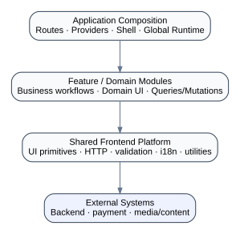

# 02 — Architecture Overview

## Architectural objective

The architectural objective is to keep the product understandable as its domains evolve independently.

This case study uses four layers as a conceptual model:

<p align="center">
  
</p>

### 1. Application composition

Responsibilities:

- route composition;
- global providers;
- application shell;
- top-level error boundaries;
- persistent media runtime;
- identity bootstrap;
- application-wide connectivity and notification surfaces.

### 2. Feature / domain modules

Responsibilities:

- business behavior;
- feature-specific UI;
- domain queries and mutations;
- feature workflow state;
- feature-level error semantics.

Examples: subscription, reader, booking, mood flow, assessments.

### 3. Shared platform

Responsibilities:

- HTTP client configuration;
- query/cache primitives;
- design-system primitives;
- validation helpers;
- locale/direction utilities;
- analytics/observability contracts;
- generic error normalization.

### 4. External systems

Responsibilities outside the frontend:

- backend APIs;
- authentication authority;
- payment provider;
- content/media storage;
- notification delivery;
- third-party audio generation/content pipeline integrations.

## Dependency direction

A healthy default is:

```text
Application → Features → Shared Platform
```

Not:

```text
Shared Platform → Feature A → Feature B internals → Feature C internals
```

The purpose is not to eliminate all coupling. The purpose is to make coupling **visible and intentional**.

## Architectural invariants

The following invariants are useful across this product shape:

1. Access decisions should be resolved through an entitlement contract, not duplicated in every screen.
2. Audio playback should not be owned by a route that is expected to unmount during navigation.
3. Server data should be fetched/cached as server state rather than manually mirrored into generic global state without a reason.
4. High-frequency state (audio time, gestures, transient progress) should not trigger broad application rerenders.
5. Booking availability is provisional until the server confirms the booking.
6. Assessment scoring should be deterministic and independently testable from presentation.
7. Directionality should be a platform concern consumed by features, not reimplemented per screen.
8. Domain components should not be forced into a generic design system solely to increase reuse counts.

## Evolving architecture

This case study does not claim the final conceptual structure existed on day one. A realistic evolution is:

```text
Delivery-first UI
  ↓
Repeated patterns emerge
  ↓
Shared primitives appear
  ↓
Cross-feature coupling becomes visible
  ↓
Domain boundaries are formalized
  ↓
Application-level capabilities (media, access, query/cache) are separated
```

The principle is **evolution in response to observed complexity**, not speculative abstraction.
