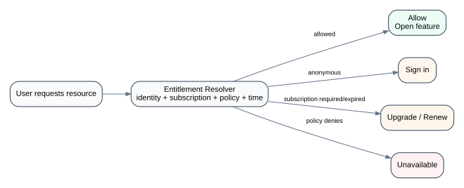

# 05 — Subscription & Entitlements

## The scaling problem

The simplest premium check is tempting:

```ts
if (user.isPremium) {
  // render premium feature
}
```

That becomes fragile when access depends on more than one boolean:

- free content;
- active subscription;
- expired subscription;
- temporary promotional access;
- feature-specific policy;
- authentication requirements;
- future plan/tier differences.

## Conceptual model

<p align="center">
  
</p>

```text
User context
+
Subscription state
+
Content access policy
+
Time-based promotion
          ↓
Entitlement Resolver
          ↓
Allowed / Sign in / Upgrade / Expired / Unavailable
```

## Why centralized policy helps

Without a policy boundary, access logic leaks into:

- cards;
- detail pages;
- audio buttons;
- reader routes;
- meditation items;
- assessment entry points.

Centralization does **not** mean one giant function. It means product rules have a clear home and a stable output contract.

## Time-limited free content

The product description includes one normally restricted item becoming available to all users for a 24-hour period.

That changes the rule from:

```text
premium user → allowed
free user    → denied
```

into:

```text
allowed when:
  content is inherently free
  OR active subscription grants access
  OR temporary access window is active
```

Time introduces additional edge cases:

- the page was opened before the promotion expired;
- client clock is inaccurate;
- cache says promotion is active after the server changes it;
- subscription expires during a session;
- promotion and subscription rules overlap.

The server should remain the authority for secure access. The frontend's responsibility is to render a consistent, recoverable experience around authoritative decisions.

## Output contract

A richer result is more useful than a boolean:

```ts
{
  allowed: false,
  reason: 'subscription-required',
  action: 'upgrade'
}
```

That lets the UI choose an experience without re-deriving business rules.

## Reference tests

See `reference-model/src/entitlements.mjs` and `reference-model/test/entitlements.test.mjs`.
