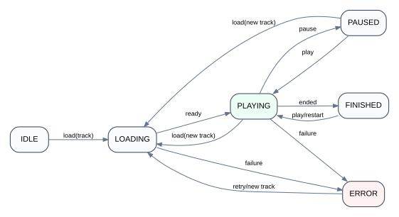

# 07 — Audio Platform

## The lifecycle problem

The product description includes continued audio playback after the user navigates away from the original book screen, with a progress surface visible on other pages.

A page-owned player creates the wrong lifecycle:

```text
Book Page
  └─ Audio Player

route change → Book Page unmounts → player disappears
```

The media lifecycle must be longer than the page lifecycle.

## Conceptual architecture

<p align="center">
  
</p>

```text
Application Shell
│
├─ Route content
│   ├─ Home
│   ├─ Explore
│   ├─ Book details
│   └─ Profile
│
└─ Audio Runtime
    ├─ current track
    ├─ playback state
    ├─ duration
    ├─ current position
    ├─ playback controls
    └─ error/recovery state
```

Different UI surfaces subscribe to the runtime:

- full player;
- mini player;
- play/pause button on content details;
- progress indicator;
- possibly lock-screen/media-session integration if implemented.

## High-frequency state

Audio position can change many times per second. Broadcasting every tick through broad application state can cause unnecessary rerenders.

A better strategy is to separate:

- low-frequency state: track identity, playing/paused, duration, error;
- high-frequency state: current playback position;
- persisted state: checkpointed progress sent to server/storage.

## Race conditions to design for

- user selects track B while track A is still loading;
- rapid play/pause input;
- seek while metadata is not ready;
- route change during load;
- protected track becomes unavailable;
- network reconnect after interruption;
- stale progress overwrites newer progress.

## Cleanup responsibilities

Application-level does not mean immortal. The runtime still needs explicit cleanup for:

- identity change/logout;
- track replacement;
- object URL or listener disposal;
- application teardown;
- unrecoverable errors.

## Reference model

The executable state machine in `reference-model/src/audio-machine.mjs` demonstrates valid transitions without publishing production audio code.
