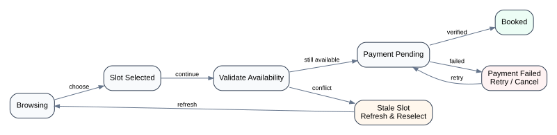

# 09 — Scheduling & Booking

## User journey

The supplied product description includes discovery, filtering/sorting, professional profiles with media and resume information, earliest availability, slot selection, payment, reminders, session participation, history, and post-session reflection.

<p align="center">
  
</p>

## Discovery problem

Users want to find an appropriate professional quickly. This can combine:

- search;
- specialization/expertise filters;
- sorting;
- earliest available appointment;
- profile detail;
- dynamic availability.

“Earliest availability” is not just UI text. It is a domain concept derived from time-sensitive slot data.

## Stale availability

The critical concurrency case:

```text
User A sees 14:00 available
User B sees 14:00 available
User A books 14:00
User B tries to continue with stale state
```

The frontend cannot guarantee slot consistency; the server must be authoritative. The frontend can guarantee **clear recovery**:

1. validate before payment when possible;
2. handle server rejection explicitly;
3. refresh availability;
4. preserve useful user context;
5. avoid presenting payment failure and slot failure as the same error.

## Workflow states

```text
Browsing
  ↓
Slot selected
  ↓
Validation
  ├─ stale → refresh/reselect
  ↓
Payment pending
  ├─ failed → retry/change method/cancel
  ↓
Booking confirmed
  ↓
Upcoming session
  ↓
Completed
  ↓
Reflection / history
```

## Payment boundaries

The frontend should avoid treating a payment redirect/callback as equivalent to final booking truth.

Useful state distinctions:

- payment initiated;
- payment provider reports return/callback;
- backend verifies transaction;
- booking is confirmed;
- booking confirmation fails despite ambiguous payment status.

The exact production payment provider and verification protocol are intentionally not disclosed.

## Time zones and calendars

The supplied stack includes Persian/Jalaali date utilities. For scheduling, date display and slot identity should remain distinct:

- server/domain timestamps should be unambiguous;
- local calendar display can be localized;
- comparing appointment identity should never depend on formatted text.

## Reference tests

See `reference-model/test/booking-machine.test.mjs` and `reference-model/test/availability.test.mjs`.
