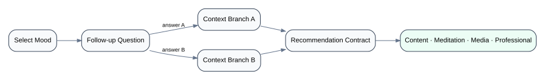

# 10 — Mood & Recommendation Engine

## Product behavior

The supplied product description includes a mood checker that starts from the user's current mood, asks follow-up questions, and recommends possible next actions such as:

- a book/content item;
- a meditation;
- a film/media suggestion;
- speaking with a professional.

The frontend architecture problem is a **dynamic multi-step decision journey**, not merely a form.

## Conceptual flow

<p align="center">
  
</p>

```text
Select mood
   ↓
Follow-up question
   ↓
Answer
   ↓
Branch or next question
   ↓
Context complete
   ↓
Recommendation response
   ↓
Book / Meditation / Media / Professional
```

## Session state

A useful session model is:

```text
MoodSession
├─ selectedMood
├─ currentStep
├─ answers
├─ derived context
├─ status
└─ recommendations
```

## Data-driven branching

Hard-coding navigation inside every question component creates brittle coupling.

A data-driven definition can express:

```text
Question A
├─ answer X → Question B
└─ answer Y → Question C
```

The renderer then becomes responsible for presentation, validation, and dispatching answers—not owning the entire decision graph.

## Recommendation boundary

This repository does **not** claim the recommendation logic was AI-based. Unless an implementation is known, the safe architecture statement is:

```text
User context → recommendation contract → normalized recommendations → frontend presentation
```

The recommendation producer may be rule-based, backend-driven, or another service. The frontend should not pretend to know more than its contract.

## Recovery behavior

High-value cases:

- user refreshes mid-flow;
- one branch definition is invalid;
- recommendation request fails;
- user changes an earlier answer;
- the user is unauthenticated for a recommended premium action.

## Reference model

See `reference-model/src/mood-flow.mjs`.
