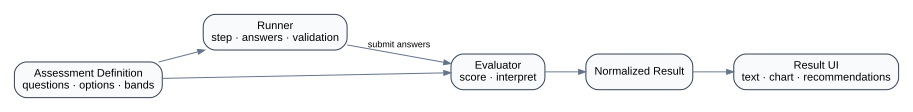

# 11 — Psychological Assessment Engine

## Product behavior

The production application included psychological tests where users answer questions and receive analyzed results with detailed explanatory output.

The frontend architecture opportunity is to model assessments as **data + engine + presentation**, rather than building a unique page and scoring implementation for every test.

## Conceptual engine

<p align="center">
  
</p>

```text
Assessment Definition
├─ metadata
├─ questions
├─ answer options
├─ scoring rules
└─ interpretation bands
       ↓
Assessment Runner
       ↓
User Answers
       ↓
Evaluation
       ↓
Normalized Result
       ↓
Result Presentation
```

## Why data-driven matters

A page-per-assessment approach tends to duplicate:

- question navigation;
- answer validation;
- progress display;
- submit state;
- scoring plumbing;
- result layout logic.

A data-driven engine enables shared mechanics while preserving assessment-specific definitions.

## Scoring boundary

Scoring should be deterministic and UI-independent:

```text
answers + definition → score/result
```

This makes boundary tests straightforward:

- minimum score;
- maximum score;
- threshold exactly at band transition;
- unanswered required question;
- invalid option;
- reverse-scored items if supported.

## Safety and communication

Psychological assessment UX should avoid presenting app output as a substitute for diagnosis or emergency care unless the underlying product and clinical governance explicitly support such claims.

This public case study focuses on frontend architecture; it does not claim clinical validation of any assessment content.

## Reference model

See `reference-model/src/assessment-engine.mjs` and its tests.
