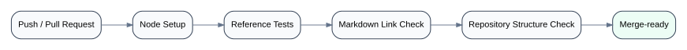

# 24 — CI/CD & Release Engineering

## Evidence boundary

The supplied production manifest contains build and lint scripts, but no private CI configuration or deployment platform was supplied. This case study therefore does not claim a specific historical pipeline.

## Recommended production merge gate

```text
Pull Request
  ↓
Lint
  ↓
Type Check
  ↓
Unit / Integration Tests
  ↓
Production Build
  ↓
Review / Approval
  ↓
Merge
  ↓
Deploy / Observe / Roll back if needed
```

Critical journey E2E tests can run on pull request, preview environment, or pre-release depending on cost and stability.

## Release risk

Higher-risk changes include:

- authentication/token handling;
- entitlement policy;
- payment/booking flows;
- service-worker caching;
- persistent state migrations;
- audio runtime changes;
- assessment scoring definitions.

These changes deserve stronger review and targeted regression coverage.

## Public repository pipeline

The included GitHub Actions workflow validates this case-study repository itself:

<p align="center">
  
</p>

It runs:

1. dependency installation from the committed lockfile;
2. all sanitized reference-model tests;
3. Markdown relative-link validation;
4. required repository/diagram structure checks.

This makes the portfolio artifact self-verifying rather than a static collection of Markdown files.
